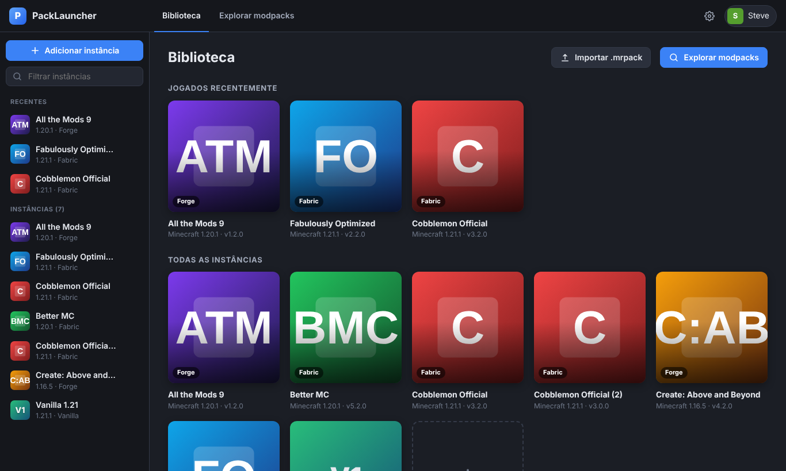
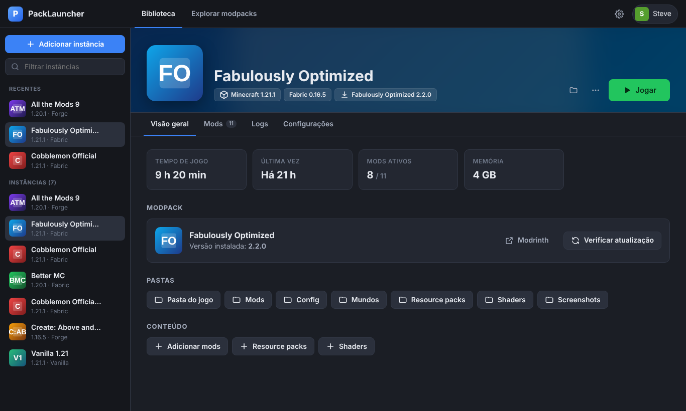
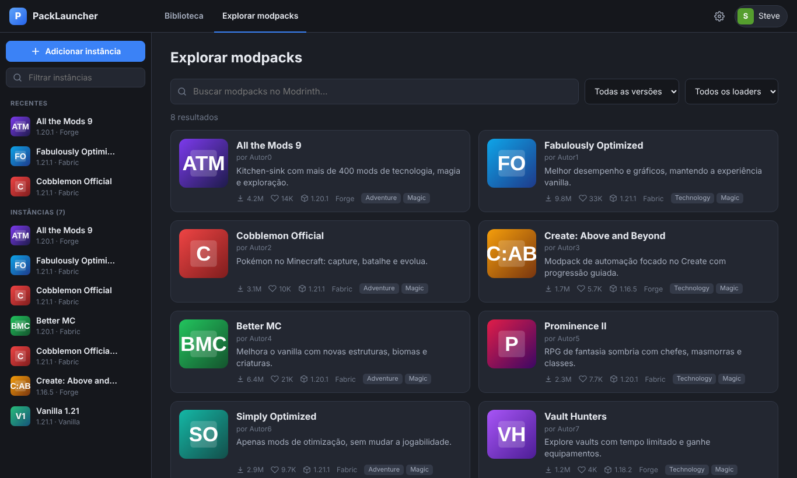

# PackLauncher

Launcher de Minecraft: Java Edition focado em **modpacks**. Busque, instale, atualize
e exporte modpacks do [Modrinth](https://modrinth.com) com um clique, sem precisar
instalar loader, Java ou mods na mão.

Escrito em Python puro (apenas biblioteca padrão), com interface gráfica moderna no
estilo do GD Launcher (tema escuro, biblioteca em cards, explorador de modpacks) e
uma CLI completa.



| Instância | Explorar modpacks |
|---|---|
|  |  |

<sub>Screenshots com dados de demonstração.</sub>

## Recursos

- **Modpacks do Modrinth**: busca com filtro de versão/loader, escolha de versão,
  instalação em uma instância isolada.
- **Importar `.mrpack`** de arquivo local, respeitando a especificação do formato:
  arquivos `client: unsupported` são ignorados, opcionais podem ser pulados,
  hashes SHA-1/SHA-512 verificados, downloads apenas de domínios permitidos e
  bloqueio de caminhos perigosos (`../`, absolutos).
- **Atualização de modpack** preservando mundos e configurações pessoais:
  - remove mods que saíram do pack;
  - mods que você desativou continuam desativados;
  - `options.txt`, `servers.dat` etc. não são sobrescritos.
- **Exportar instância como `.mrpack`**: mods encontrados no Modrinth viram links,
  o resto (configs, mods próprios) vai para `overrides/`.
- **Gerenciar mods**: ativar/desativar, adicionar mods, resource packs e shaders
  do Modrinth (com dependências obrigatórias).
- **Loaders**: Fabric, Quilt, Forge e NeoForge instalados automaticamente.
- **Java automático**: detecta o Java instalado na versão exigida pelo Minecraft
  (8, 17, 21…) ou baixa o Eclipse Temurin certo.
- **Contas**: offline e Microsoft (device code).
- Bibliotecas, assets e runtimes compartilhados entre instâncias (economiza disco);
  downloads paralelos com verificação de hash e novas tentativas.
- Tempo de jogo, logs por instância, memória/JVM/resolução por instância.

## Instalação

Requer Python 3.9+. A interface abre como janela de aplicativo no Chrome, Edge,
Brave ou Chromium (se nenhum estiver instalado, abre no navegador padrão).

```bash
git clone https://github.com/spk768/random.git
cd random
pip install .            # opcional: instala o comando `packlauncher`
python -m packlauncher   # abre a interface gráfica
```

## Interface gráfica

```bash
python -m packlauncher
```

1. Clique na conta (canto superior direito) → adicione uma conta offline ou Microsoft.
2. **Explorar modpacks** → escolha um modpack → selecione a versão → **Instalar**.
   O progresso aparece na barra lateral e no card da instância.
3. Na **Biblioteca**, passe o mouse sobre o card e clique em **▶**.

Telas:

- **Biblioteca**: cards com a arte do modpack, "Jogados recentemente", botão de
  jogar direto no card, indicador de instância em execução.
- **Instância**: cabeçalho com a arte do pack, botão Jogar/Fechar e abas
  *Visão geral* (tempo de jogo, atualização do modpack, pastas), *Mods*
  (ativar/desativar com interruptor, buscar, remover, adicionar do Modrinth),
  *Logs* (saída do jogo em tempo real) e *Configurações* (memória, Java, JVM, resolução).
  Menu **⋯**: duplicar, exportar `.mrpack`, excluir.
- **Explorar**: busca no Modrinth com filtros de versão e loader; detalhes com galeria
  e seleção de versão. A partir de uma instância, explora mods, resource packs e shaders
  compatíveis.
- **Adicionar instância**: personalizada (versão + loader), importar `.mrpack`
  (ou arraste o arquivo para a janela) ou modpack do Modrinth.

`python -m packlauncher gui --no-window` só inicia o servidor local e mostra a URL.
A interface é servida apenas em `127.0.0.1` e protegida por um token aleatório.

## Linha de comando

```bash
packlauncher search "create" --loader fabric --mc 1.20.1   # busca modpacks
packlauncher versions fabulously-optimized                # versões de um modpack
packlauncher install fabulously-optimized                 # instala a mais recente
packlauncher install ./meupack.mrpack --name "Meu Pack"    # importa arquivo
packlauncher list                                          # lista instâncias
packlauncher account offline Steve                         # conta offline
packlauncher launch "Fabulously Optimized"               # joga
packlauncher update "Meu Pack" --check                     # verifica atualização
packlauncher update "Meu Pack"                             # atualiza
packlauncher mods "Meu Pack" --disable algum-mod.jar       # desativa um mod
packlauncher mods "Meu Pack" --add sodium                  # adiciona do Modrinth
packlauncher export "Meu Pack" --version-number 1.1.0      # gera .mrpack
packlauncher create "Vanilla" --mc 1.21.1                  # instância sem modpack
packlauncher create "Fabric" --mc 1.21.1 --loader fabric
packlauncher launch "Meu Pack" --dry-run                   # instala tudo e mostra o comando
packlauncher config default_memory_mb 6144                 # configurações globais
```

## Login com conta Microsoft

A Microsoft exige que cada launcher use um *Client ID* próprio do Azure, e a Mojang
precisa aprovar esse app para acessar a API do Minecraft
([formulário](https://aka.ms/mce-reviewappid)). Por isso o launcher não traz um ID
embutido:

1. Crie um registro de aplicativo em <https://portal.azure.com> (contas pessoais
   Microsoft, "Allow public client flows" ativado).
2. Solicite a aprovação da Mojang para o ID.
3. Configure: `packlauncher config msa_client_id <ID>` (ou a variável de ambiente
   `PACKLAUNCHER_MSA_CLIENT_ID`).

Contas offline funcionam sem isso (servidores em modo offline / LAN / singleplayer).
Os tokens ficam em `accounts.json` na pasta de dados (permissão 600 em Linux/macOS).

## Onde ficam os arquivos

| Sistema | Pasta |
|---|---|
| Windows | `%APPDATA%\PackLauncher` |
| macOS | `~/Library/Application Support/PackLauncher` |
| Linux | `~/.local/share/PackLauncher` |

Pode ser alterada com a variável `PACKLAUNCHER_HOME`. Cada instância fica em
`instances/<nome>/minecraft` (mundos, mods, configs).

## Observações

- Forge/NeoForge são instalados executando o instalador oficial em modo headless
  (`--installClient`), o que funciona com as versões modernas (1.13+). Versões muito
  antigas do Forge podem não suportar isso.
- Modpacks do CurseForge não são suportados (a API exige chave); use a versão
  Modrinth do pack ou exporte-o para `.mrpack`.

## Testes

```bash
python -m unittest discover -s tests -v
```
